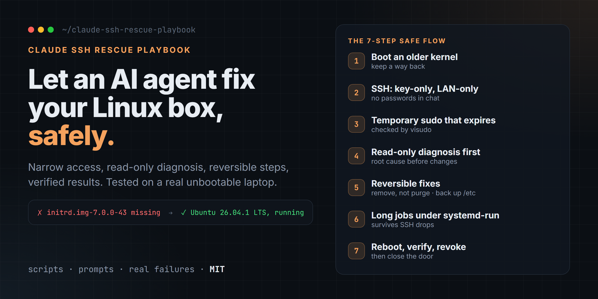

<p align="center">
  
</p>

# Claude SSH Rescue Playbook

**How to let an AI coding agent (Claude Code) SSH into a broken Linux machine and fix it, without giving away more access than you need.**

My Ubuntu laptop stopped booting on its newest kernel. I booted it on an older kernel, gave Claude temporary access over SSH, and got:

- the root cause in about 10 minutes,
- the fix applied and tested with a reboot,
- an in-place upgrade from Ubuntu 24.04 to **26.04.1 LTS** (about 2,300 packages),
- a full DevOps toolchain installed (VirtualBox, Docker, Kubernetes tools, Terraform, Ansible…).

No data was lost. VMs, Docker and settings were kept.

This repo is the playbook I'd follow again, with the scripts, the prompts, and every mistake we hit along the way.

> [!IMPORTANT]
> An agent with `sudo` on your machine is **root on your machine**. This guide is about keeping that access **narrow** (one machine, your LAN only, SSH key only), **short** (temporary sudo that removes itself) and **visible** (you see and can stop every command).

---

## Contents

- [The 7-step safe flow](#the-7-step-safe-flow)
- [Step by step](#step-by-step)
- [Prompts you can copy](#prompts-you-can-copy)
- [What went wrong (and what it taught us)](#what-went-wrong-and-what-it-taught-us)
- [Guardrails checklist](#guardrails-checklist)
- [What not to do](#what-not-to-do)
- [Files in this repo](#files-in-this-repo)
- [Full case study](docs/case-study.md)

---

## The 7-step safe flow


| # | Step | Why it matters |
|---|------|----------------|
| 1 | **Boot an older kernel** from GRUB → *Advanced options* | You need a working system before you can let anyone in. Keep it as your fallback. |
| 2 | **Enable SSH with a key, from your LAN only** | No passwords in chat, nothing open to the internet. |
| 3 | **Temporary passwordless sudo**, validated by `visudo` and set to **expire automatically** | The agent can work non-interactively, and the access goes away even if you forget. |
| 4 | **Read-only diagnosis first** | The agent has to find the root cause before it changes anything. |
| 5 | **Reversible fixes**: `apt remove` (not `purge`), rename instead of delete, back up `/etc` | Every change can be undone. |
| 6 | **Run long jobs as a `systemd-run` unit** | A dropped SSH connection doesn't kill a half-finished upgrade. |
| 7 | **Reboot, verify, revoke** | "It works" means it survived a reboot. Then close the door. |

---

## Step by step

### 0. Before you start

- [ ] You can **physically reach** the machine. If something goes wrong you need its keyboard.
- [ ] Both machines are on the **same local network** (same Wi-Fi or router).
- [ ] You have a **backup of anything you can't lose** (`/home` at minimum). A release upgrade is the riskiest step here.
- [ ] Claude Code runs in a permission mode where **you see each command**. You can interrupt at any time.

### 1. Boot something that works

At power-on, tap **Esc** (UEFI) or hold **Shift** (BIOS) to open GRUB. Choose **Advanced options for Ubuntu**, then the **second entry** (the previous kernel). If no kernel boots, choose a **(recovery mode)** entry, then *network* and *root*.

### 2. Open a narrow door: SSH, key-only, LAN-only

On the **machine Claude will run on**, get your public key (create one with `ssh-keygen -t ed25519` if you don't have one):

```bash
cat ~/.ssh/id_ed25519.pub
```

On the **broken machine**, run [`scripts/01-enable-ssh.sh`](scripts/01-enable-ssh.sh) with that key:

```bash
./01-enable-ssh.sh "ssh-ed25519 AAAA... you@your-pc"            # add your key
./01-enable-ssh.sh "ssh-ed25519 AAAA... you@your-pc" --key-only  # optionally also turn off SSH password logins
```

It installs `openssh-server`, adds your key, allows port 22 **only from your local network** (when `ufw` is active), and prints the **user** and **IP** to give Claude.

### 3. Temporary sudo that validates itself and expires

Most fixes need root, and the agent can't type your sudo password over a non-interactive SSH session. Grant it **temporarily**:

```bash
./02-grant-temp-sudo.sh 4     # passwordless sudo for 4 hours, then it removes itself
```

The script ([`02-grant-temp-sudo.sh`](scripts/02-grant-temp-sudo.sh)):

1. writes the rule to a temp file and checks it with **`visudo -cf`** first, so a broken rule can never be installed;
2. installs it as `/etc/sudoers.d/90-claude-temp` (mode `0440`);
3. creates a **persistent systemd timer** that deletes the rule at the expiry time. It still fires after reboots, even if the machine was off at that moment.

> [!WARNING]
> In my session I typed this rule by hand and wrote `NO PASSWD` with a space. That's a sudoers syntax error. Modern sudo skips the broken line, but **older versions refuse to run at all**, and then you're locked out of sudo. Always validate with `visudo`.

### 4. Let Claude diagnose. Read-only first

Ask for a **read-only** pass and a root-cause explanation **before** any change. [`scripts/preflight.sh`](scripts/preflight.sh) collects what a kernel or boot problem usually needs without changing anything: installed kernels, `/boot` contents, half-configured packages, DKMS modules, boot history and errors, GRUB settings, Secure Boot state.

In my case the output showed the cause right away:

```text
$ ls /boot
vmlinuz-7.0.0-43-generic          # kernel present...
initrd.img-6.14.0-36-generic      # ...but only the OLD kernel has an initrd

$ dpkg --audit
 linux-image-7.0.0-43-generic     # half-configured
 virtualbox-dkms                  # half-configured

ERROR: modpost: module vboxdrv uses symbol kvm_enable_virtualization
       from namespace module:kvm-amd,kvm-intel, but does not import it.
```

**Root cause:** Ubuntu's VirtualBox 7.0.16 kernel module couldn't build against kernel 7.0. That failure aborted the kernel's post-install step, so **no `initrd.img` was created** and the kernel couldn't boot.

### 5. Fix with reversible steps

- **Look before removing.** Before removing VirtualBox, Claude listed the VMs (3 VMs, 4.6 GB) and confirmed `apt remove` would leave them alone.
- **`apt remove`, not `purge`.** Configs stay, so reinstalling later picks them up.
- **Rename, don't delete.** Blocked package sources became `docker.list.disabled`, not `rm`.
- **Back up config before big changes.** `sudo cp -a /etc /root/etc-backup-pre-upgrade`.
- **Leave yourself a way back.** The old kernel stayed installed, and the GRUB menu was set to show for 5 seconds (`GRUB_TIMEOUT_STYLE=menu`, `GRUB_TIMEOUT=5`).

### 6. Long jobs must survive a dropped connection

A release upgrade **replaces the SSH server while you're connected through it**. In my session SSH went down partway through the upgrade. The upgrade kept going because it wasn't tied to the SSH session:

```bash
sudo systemd-run --unit=release-upgrade \
  --setenv=DEBIAN_FRONTEND=noninteractive \
  /usr/bin/do-release-upgrade -f DistUpgradeViewNonInteractive

journalctl -u release-upgrade -f        # follow it from any new SSH session
```

`tmux` or `screen` also work. A plain `ssh host 'do-release-upgrade'` does **not**.

### 7. Reboot, verify, revoke

"It works" means **it survived a reboot**:

```bash
uname -r; lsb_release -ds
systemctl is-system-running        # want: running
systemctl --failed
dpkg --audit && sudo apt-get check
journalctl -b -p err
```

Then close the door with [`scripts/03-revoke-access.sh`](scripts/03-revoke-access.sh):

```bash
./03-revoke-access.sh                                   # remove temp sudo + expiry timer
./03-revoke-access.sh --remove-key "you@your-pc"        # also remove the SSH key
./03-revoke-access.sh --remove-key "you@your-pc" --disable-ssh
```

It checks that `sudo` asks for a password again and warns you if some other rule still grants passwordless sudo.

---

## Prompts you can copy

These are close to what I actually typed. The agent does better with clear limits than with a vague "fix my laptop".

**1. Getting access**
> I have an Ubuntu laptop next to me on the same network. It won't boot the latest kernel. What do I need to do so you can SSH into it? Use my SSH key, not a password.

**2. Diagnosis (read-only)**
> SSH to `user@<ip>`. Read-only first: collect kernel packages, /boot contents, dpkg state, DKMS status, boot logs and GRUB config. Don't change anything until you've explained the root cause and the fix you propose.

**3. The fix**
> Go ahead with the fix. Before removing any package, check what data or VMs depend on it. Prefer `apt remove` over `purge`. Reboot into the fixed kernel and verify.

**4. A big upgrade**
> Upgrade to the latest LTS in place. Back up /etc first, run the upgrade so a dropped SSH connection can't kill it, and show me a progress bar with an ETA.

**5. Closing**
> We're done. Remove the temporary sudo rule and confirm sudo asks for a password again.

> [!TIP]
> You can stop the agent at any point. When I interrupted Claude in the middle of a step, it stopped and listed exactly what might be **half-applied** and how to clean it up. Ask for that if it doesn't offer.

---

## What went wrong (and what it taught us)

Every row happened in the real session.

| Symptom | Root cause | Fix | Lesson |
|---|---|---|---|
| Newest kernel won't boot | `virtualbox-dkms` 7.0.16 failed to build for kernel 7.0, so the kernel post-install aborted and no `initrd.img` was made | Remove the DKMS package (`apt remove`), then `dpkg --configure -a` | Every `vmlinuz-*` in `/boot` needs a matching `initrd.img-*`. `dpkg --audit` shows half-installed kernels. |
| `sudo` still asks for a password after granting it | Typo: `NO PASSWD` (with a space) is a syntax error | Rewrite the rule, check with `visudo -c` | Never write sudoers without `visudo`. |
| The monitoring SSH session died (exit 255) during the upgrade | The upgrade was replacing `openssh-server` | Nothing, because the upgrade ran as a `systemd-run` unit | Don't run long jobs in a plain SSH session. |
| `403 Forbidden` from Docker, HashiCorp and VirtualBox package sources | The target network was geo-blocked | Disable those sources. Download on a machine that can reach them, **verify SHA256**, then `scp` | Third-party package sources are the most common thing to break an upgrade. Check them first. |
| `docker pull` denied | Docker Hub blocked on that network | A registry mirror in `/etc/docker/daemon.json` | Restricted networks need mirrors. Test with `docker run hello-world`. |
| `pipx` won't install after the upgrade | The deadsnakes PPA's Python 3.14 built for **24.04** survived the upgrade and was mixed with Ubuntu's own 3.14 | Downgrade to Ubuntu's build, **pin the PPA to priority 100** | After a release upgrade, check `dpkg -l \| grep -E 'noble\|24\.04'` for leftovers. |
| `kubectl` segfaults | An old **truncated download** (1.4 MB instead of ~58 MB) | Re-download with a `sha256` check | Verify every binary you install. `file` showed "too large section header offset". |
| Pods inside a `kind` cluster can't pull images | kind's own containerd **ignores the host Docker's mirror** | containerd `hosts.toml` mirror config for kind/k3d *(sketched, not verified: I stopped the session)* | Mirrors are configured per container runtime, not once per machine. |

---

## Guardrails checklist

- [ ] Physical access to the machine, plus a known-good fallback kernel
- [ ] SSH **key** auth only. No passwords shared in the chat
- [ ] SSH allowed **from the LAN only**. No port forwarding, no public IP
- [ ] Sudo access is **temporary**, **validated** and **auto-expiring**
- [ ] **Read-only diagnosis** and a stated root cause before the first change
- [ ] Anything destructive is **inspected first** (what data depends on it?)
- [ ] Reversible choices: `remove` over `purge`, `.disabled` over `rm`, `/etc` backup
- [ ] Downloads verified with **checksums**
- [ ] Long jobs run under **systemd-run / tmux**
- [ ] Final **reboot test** + `systemctl --failed` + `dpkg --audit`
- [ ] Access **revoked**, and you've confirmed sudo asks for a password again
- [ ] Review what was done: `journalctl _COMM=sudo` and `/var/log/apt/history.log`

## What not to do

- ❌ Don't expose SSH to the internet "just for this session".
- ❌ Don't paste your password into the chat.
- ❌ Don't leave `NOPASSWD:ALL` in place after the session.
- ❌ Don't run a release upgrade without a fallback kernel and a backup.
- ❌ Don't `curl … | sudo bash` anything nobody has read, whether you or the agent.
- ❌ Don't let "it booted once" count as verified. Reboot again.

---

## Files in this repo

```text
.
├── README.md                    ← this playbook
├── docs/
│   └── case-study.md            ← full timeline, commands and real error output
├── scripts/                     ← run these on the TARGET machine
│   ├── 01-enable-ssh.sh         ← SSH server + your key + LAN-only firewall rule
│   ├── 02-grant-temp-sudo.sh    ← validated, auto-expiring passwordless sudo
│   ├── preflight.sh             ← read-only diagnostics for boot/kernel problems
│   └── 03-revoke-access.sh      ← remove sudo (and optionally the key / SSH)
└── assets/
    └── social-preview.png       ← the banner above
```

Make the scripts executable after cloning: `chmod +x scripts/*.sh`. Read them before you run them. They're short on purpose.

## Disclaimer

This is what worked on one Ubuntu laptop (Lenovo, Intel graphics, 24.04 → 26.04.1). Your hardware, kernels and package sources will differ. The playbook is about the **process**: narrow access, read-only diagnosis, reversible steps, verified results. It isn't a script to run blindly.

## License

[MIT](LICENSE). Use it, adapt it, share it.
